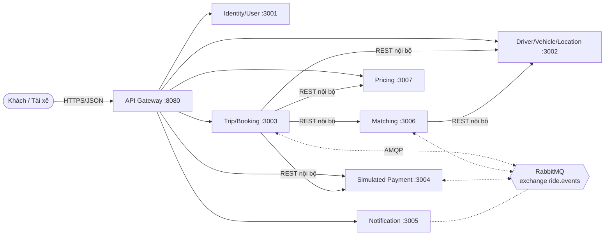
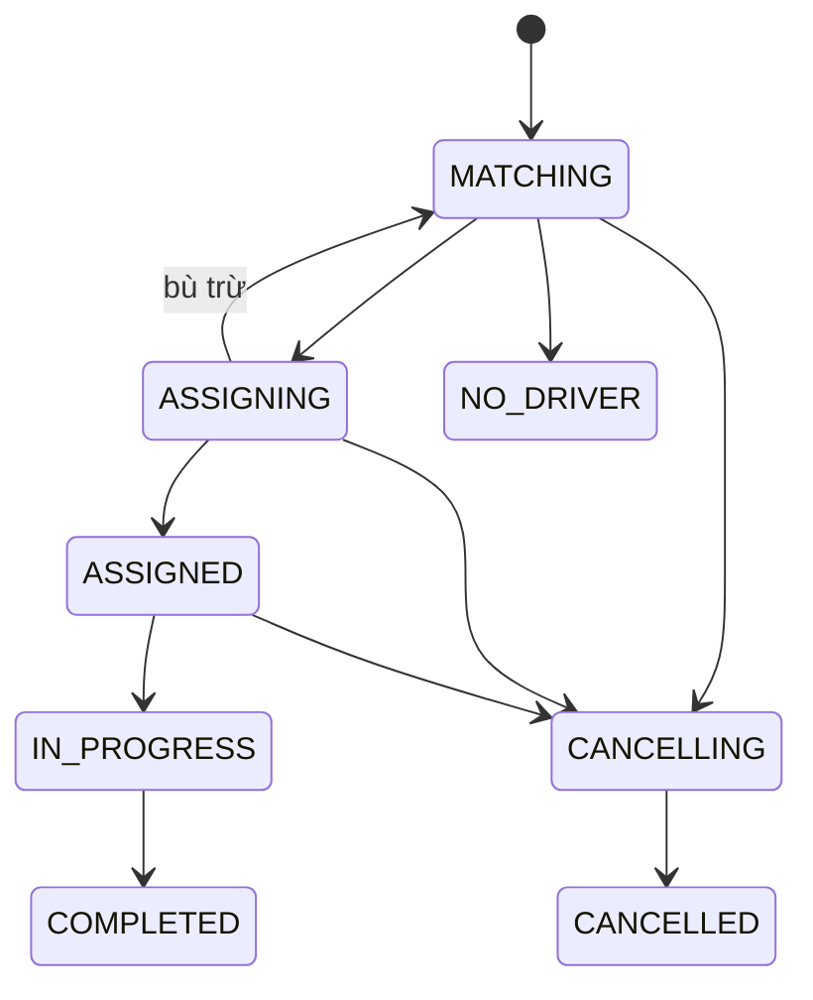

# DS03 – Hệ thống gọi xe theo kiến trúc microservices mô phỏng Grab/Uber

Bài tập lớn môn **Hệ thống phân tán**, đề tài **DS03**. Hệ thống gồm **7 microservice nghiệp vụ** và
**1 API Gateway** viết bằng TypeScript/NestJS. Mỗi service chạy thành một tiến trình (container) riêng,
có PostgreSQL riêng, giao tiếp **đồng bộ bằng REST** và **bất đồng bộ qua RabbitMQ**. Hệ thống có Saga
với bước bù trừ, Transactional Outbox, retry có giới hạn, khử trùng, dead-letter queue và correlation ID.

- Báo cáo: [docs/report.pdf](docs/report.pdf)
- Kịch bản demo: [docs/demo/kich-ban-demo.md](docs/demo/kich-ban-demo.md) (kỹ thuật),
  [docs/demo/kich-ban-demo-chi-tiet.md](docs/demo/kich-ban-demo-chi-tiet.md) (lời thoại, phân vai, câu hỏi vấn đáp)
- Hợp đồng API và sự kiện: [docs/api/](docs/api/)

## Mục lục

1. [Thành viên và phân công](#1-thành-viên-và-phân-công)
2. [Kiến trúc](#2-kiến-trúc)
3. [Các vấn đề phân tán và cách giải quyết](#3-các-vấn-đề-phân-tán-và-cách-giải-quyết)
4. [Yêu cầu môi trường](#4-yêu-cầu-môi-trường)
5. [Cài đặt và chạy](#5-cài-đặt-và-chạy)
6. [Kịch bản demo](#6-kịch-bản-demo)
7. [Kiểm thử và đánh giá](#7-kiểm-thử-và-đánh-giá)
8. [Cấu trúc repository](#8-cấu-trúc-repository)
9. [Hạn chế](#9-hạn-chế)

## 1. Thành viên và phân công

| Thành viên | Phụ trách | Mã nguồn chính | Test và bằng chứng |
| --- | --- | --- | --- |
| **Phạm Quốc Hùng** (A) | Identity/User (đăng ký, đăng nhập, bcrypt, JWT RS256, vai trò); Trip/Booking (vòng đời chuyến, Saga nhận/hủy/kết thúc chuyến, đối soát thanh toán, `ops:retry`) | `src/services/identity-user-service/`, `src/services/trip-booking-service/`, `src/packages/auth/` | `test:identity:*`, `test:trip:*`, `test:e2e`, `test:contract`; `docs/test-evidence/identity/`, `docs/test-evidence/trip/` |
| **Nguyễn Bá Thọ** (B) | Driver/Vehicle/Location (hồ sơ, xe, GPS, giữ tài xế chống gán trùng); Pricing (báo giá CAR_V1); Matching (mời tài xế, hết hạn lời mời); xác thực nội bộ và idempotency trong `@app/runtime` | `src/services/driver-vehicle-location-service/`, `src/services/pricing-service/`, `src/services/matching-service/`, `src/packages/runtime/` | `test:driver:*`, `test:pricing:*`, `test:matching:*`, `test:runtime:*`; `docs/test-evidence/driver/`, `pricing/`, `matching/` |
| **Lê Hải Sơn** (C) | Simulated Payment; Notification; thư viện RabbitMQ `@app/messaging` (outbox, retry, DLQ); API Gateway; Docker Compose; demo 9 bước; test tải P01 | `src/services/simulated-payment-service/`, `src/services/notification-service/`, `src/packages/messaging/`, `src/apps/api-gateway/`, `deploy/`, `scripts/demo/` | `test:c:*`, `test:gateway`, `test:p01`, `demo`; `docs/test-evidence/c/`, `demo/`, `performance/` |

Mỗi thành viên tự làm migration, test và tài liệu cho phần của mình; C tích hợp môi trường chung.
Lịch sử commit của từng người: `git shortlog -sn --all`.

## 2. Kiến trúc

### 2.1. Thành phần

Khi chạy bằng Docker Compose, hệ thống có **16 tiến trình độc lập**: 1 Gateway, 7 service nghiệp vụ,
7 PostgreSQL và 1 RabbitMQ (chưa kể container chạy migration). Client chỉ thấy Gateway; Trip là nơi
điều phối, gọi REST khi cần câu trả lời ngay và phát sự kiện khi chỉ cần báo tin.



| Thành phần | Cổng | Database | Trách nhiệm | Bất biến sở hữu |
| --- | ---: | --- | --- | --- |
| API Gateway | 8080 | — | Xác thực JWT, định tuyến theo danh sách cho phép, rate limit, xoá header giả | Chỉ route public đi qua |
| Identity/User | 3001 | `identity_db` | Tài khoản, vai trò `PASSENGER`/`DRIVER`, bcrypt, cấp JWT | Email duy nhất |
| Driver/Vehicle/Location | 3002 | `driver_db` | Hồ sơ, xe, GPS mới nhất, trạng thái nhận chuyến, giữ/xác nhận/trả tài xế | Một tài xế chỉ có một reservation đang hoạt động |
| Trip/Booking | 3003 | `trip_db` | Vòng đời chuyến, Saga, operation, đối soát thanh toán | Chuyến chỉ đi theo chuyển trạng thái hợp lệ |
| Simulated Payment | 3004 | `payment_db` | Thu tiền mô phỏng (5 chế độ lỗi), lưu lịch sử lần thử | Mỗi `(paymentId, attemptNo)` chỉ thu một lần |
| Notification | 3005 | `notification_db` | Biến sự kiện thành thông báo cho đúng người, giữ bản sao trạng thái chuyến | Không lùi trạng thái khi tin đến sai thứ tự |
| Matching | 3006 | `matching_db` | Việc tìm tài xế, chọn ứng viên, tạo và hết hạn lời mời | Mỗi lời mời chỉ được claim một lần |
| Pricing | 3007 | `pricing_db` | Bảng giá CAR_V1, báo giá có hạn 300 s | Giá của một báo giá không đổi |

Mỗi service chỉ có địa chỉ và mật khẩu DB của chính nó (user DB riêng, quyền hẹp); không service nào đọc
DB của service khác. Dữ liệu cần dùng lại được chụp vào DB của bên dùng kèm số phiên bản
(Trip giữ `fare_snapshots`, Notification giữ `trip_projection`).

### 2.2. Định danh và khám phá dịch vụ

- **Định danh nghiệp vụ**: UUID cho `userId`, `driverId`, `quoteId`, `tripId`, `offerId`, `reservationId`,
  `assignmentId`, `operationId`, `paymentId`, `event_id`. Bên gọi sinh mã lệnh trước khi gửi nên gửi lại
  bao nhiêu lần cũng là một lệnh.
- **Định danh tiến trình**: tên service cố định + `instanceId` (UUID sinh lúc khởi động), có trong
  `/health` và mọi dòng log.
- **Định danh bên gọi nội bộ**: header `X-Service-Token`, mỗi cặp gọi–nhận một token riêng; bên nhận suy
  ra bên gọi từ token, không tin tên tự khai. Sai/thiếu → 401, không được phép → 403.
- **Khám phá dịch vụ**: DNS của mạng Docker (`trip`, `pricing`, …), cấu hình qua `<SERVICE>_BASE_URL`
  (ví dụ `TRIP_BASE_URL=http://trip:3003`). Bên phát sự kiện không cần biết bên nhận; RabbitMQ định tuyến
  theo `type`.
- **Phát hiện online/offline**: `/health/live` (tiến trình sống), `/health/ready` (kiểm tra DB và RabbitMQ
  thật, trả 503 khi mất phụ thuộc); Docker healthcheck dùng hai endpoint này. GPS của tài xế là heartbeat:
  quá 60 s không có GPS mới thì tài xế bị coi là offline.

### 2.3. Giao thức và định dạng thông điệp

**REST/JSON.** API public có tiền tố `/api/v1` và đi qua Gateway; API nội bộ `/internal/v1` chỉ đi trong
mạng Docker (Gateway chặn). Thao tác nhiều bước (nhận, từ chối, hủy, hoàn thành chuyến) trả
`202 { operationId }`, client theo dõi qua `GET /api/v1/operations/{id}`. Mọi lỗi có dạng
`{ code, message, correlationId }`. Đặc tả: [identity.openapi.json](docs/api/identity.openapi.json),
[trip.openapi.json](docs/api/trip.openapi.json).

| Nhóm | Endpoint chính | Vai trò |
| --- | --- | --- |
| Tài khoản | `POST /auth/register`, `POST /auth/login`, `GET /users/me` | Mọi người |
| Tài xế | `PUT /drivers/me`, `POST /vehicles`, `PUT /drivers/me/location`, `PATCH /drivers/me/status` | DRIVER |
| Báo giá | `POST /quotes`, `GET /quotes/{id}` | PASSENGER |
| Chuyến đi | `POST /trips`, `GET /trips`, `GET /trips/{id}`, `POST /trips/{id}/accept\|reject\|cancel\|start\|complete` | PASSENGER / DRIVER |
| Thanh toán | `GET /payments/{id}`, `GET /payments?tripId=` | Chủ chuyến |
| Thông báo | `GET /notifications`, `PATCH /notifications/{id}/read` | Chủ thông báo |

**Sự kiện AMQP.** Mọi sự kiện dùng chung một envelope JSON, được kiểm tra bằng validator lúc nhận
([events.schema.json](docs/api/events.schema.json), mẫu trong [docs/events/samples/](docs/events/samples/)):

```json
{
  "event_id": "83f4dd9c-3da5-5e7a-9790-386912f9e984",
  "type": "trip.requested",
  "schema_version": 1,
  "aggregate_id": "a1031bdc-44d7-5c67-93ff-7f11b2987aa4",
  "aggregate_version": 1,
  "occurred_at": "2026-10-11T02:00:00Z",
  "correlation_id": "96214f40-18f4-55f8-a411-75ce0f9f1790",
  "causation_id": "541af9b9-e8c6-5cec-800d-abeabc2cccd3",
  "producer": "trip-booking-service",
  "payload": { "tripId": "...", "pickup": { "zoneId": "ZONE_A" }, "amount": "41000", "currency": "VND" }
}
```

| Sự kiện | Bên phát | Bên nhận |
| --- | --- | --- |
| `trip.requested` | Trip | Matching |
| `matching.offer.created` | Matching | Notification |
| `matching.failed` | Matching | Trip |
| `trip.no_driver`, `trip.accepted`, `trip.started` | Trip | Notification |
| `trip.completed` | Trip | Notification |
| `trip.cancelled` | Trip | Matching, Notification |
| `payment.requested` | Trip | Payment |
| `payment.succeeded`, `payment.failed` | Payment | Trip, Notification |

Topology: topic exchange `ride.events`; 4 hàng đợi `matching.events`, `trip.events`, `payment.events`,
`notification.events`; mỗi hàng có `.retry.1s`, `.retry.5s`, `.retry.15s` (hết TTL thì quay về hàng gốc)
và `.dlq`. Nguồn duy nhất của routing: `src/packages/contracts/src/events/catalog.ts`.

**Máy trạng thái chuyến** (`trip-transition.ts`); chuyển không hợp lệ nhận 409:



### 2.4. Timeout, xác nhận và thử lại

| Điểm giao tiếp | Timeout | Xác nhận | Thử lại |
| --- | --- | --- | --- |
| Client → Gateway → service | 10 s tại Gateway | HTTP status | Client gửi lại cùng `Idempotency-Key` |
| HTTP nội bộ | 2 s mỗi lần | HTTP status | Tối đa 3 lần với 502/503/504/mất kết nối, nghỉ 0,5 s rồi 1,5 s; chỉ với lệnh chống trùng được |
| Outbox relay → RabbitMQ | — | Publisher confirm + `mandatory` | Chưa confirm thì giữ `PENDING`, vòng sau gửi lại |
| RabbitMQ → consumer | — | ACK thủ công sau commit | 1 s, 5 s, 15 s rồi vào DLQ |
| Lời mời / giữ tài xế / việc tìm | 15 s / 30 s / 60 s | Trạng thái trong DB | Worker nền thu hồi khi hết hạn |

## 3. Các vấn đề phân tán và cách giải quyết

### 3.1. Đồng thời và nhất quán

Mô hình nhất quán: **mạnh trong từng service, cuối cùng (eventual) giữa các service**. Mỗi bất biến thuộc
đúng một service và được giữ bằng transaction PostgreSQL cục bộ; các bản sao ở service khác hội tụ sau vài
giây qua sự kiện và đối soát.

| Xung đột | Cơ chế |
| --- | --- |
| Hai khách cùng giành một tài xế | Driver khoá hàng `SELECT … FOR UPDATE` + chỉ mục duy nhất có điều kiện `ON reservations(driver_id) WHERE status IN ('HELD','CONFIRMED')`; bên thua nhận `DRIVER_UNAVAILABLE`, Saga bù trừ |
| `start` và `cancel` cùng lúc trên một chuyến | Mọi thay đổi chuyến đi qua một hàm: khoá hàng, kiểm tra `TRIP_TRANSITIONS`, tăng `version`, ghi `state_history` trong cùng transaction |
| Client gửi lại cùng lệnh | Header `Idempotency-Key` (UUID), lưu cùng transaction 24 giờ; lệnh nội bộ dùng `command_results` |
| RabbitMQ giao lại sự kiện | `processEventOnce` ghi `event_id` vào `processed_events` trong transaction xử lý, ACK sau commit (at-least-once + khử trùng) |
| Sự kiện đến sai thứ tự | `aggregate_version`: Notification bỏ cập nhật cũ hơn bản đang giữ |
| Deadlock, lỗi serialization | `runInTransaction` chạy lại tối đa 3 lần |

### 3.2. Giao dịch phân tán: Saga nhận chuyến

Nhận chuyến đổi dữ liệu ở Trip, Matching và Driver nên Trip điều phối bằng Saga (orchestration), ghi từng
bước vào `operations` và `saga_steps` trước khi thực hiện để có thể chạy tiếp sau khi khởi động lại.

- Các bước: `CLAIM_OFFER → RESERVE_DRIVER → CONFIRM_DRIVER → COMMIT_ASSIGNMENT → FINALIZE_MATCHING → PUBLISH_AND_FINISH`.
- Nhánh bù trừ: `RELEASE_DRIVER → RESOLVE_RETRY → RETURN_TO_MATCHING`.
- Kết quả: `SUCCEEDED`, `FAILED_COMPENSATED` (đã trả tài xế, chuyến về `MATCHING`) hoặc
  `FAILED_NEEDS_REVIEW` (hết lượt thử, người vận hành chạy `npm run ops:retry -- <operationId> "<lý do>"`).
- Hủy chuyến và kết thúc chuyến dùng cùng khung Saga.

### 3.3. Chịu lỗi và phục hồi

Mô hình lỗi: tiến trình dừng đột ngột rồi khởi động lại (crash-recovery) với dữ liệu bền trong volume;
thông điệp hoặc phản hồi bị mất, trễ, trùng, sai thứ tự; broker khởi động lại. Không xét lỗi Byzantine.

| Cơ chế | Cách cài đặt |
| --- | --- |
| Transactional Outbox | Ghi nghiệp vụ và sự kiện vào `<schema>.outbox_events` cùng transaction; relay gửi qua confirm channel |
| Retry có giới hạn | Consumer 3 lần (1 s/5 s/15 s); HTTP nội bộ 3 lần; thanh toán 3 lần với cùng `paymentId` |
| Dead-letter queue | Tin sai cấu trúc, `NonRetryableEventError` hoặc hết lượt → `<queue>.dlq` kèm `x-error-code`; xem/gửi lại bằng `npm run events:dlq -- <queue> --replay` |
| Kết quả không xác định | Hết lượt mà `outcomeUnknown = true` thì hỏi lại bằng cùng mã thay vì coi là thất bại |
| Tombstone | Reservation đã trả để lại dấu vết, chặn lệnh giữ đến muộn |
| Lease có hạn | Reservation `HELD` 30 s, lời mời 15 s, việc tìm 60 s; worker tự thu hồi |
| Đối soát định kỳ | Mỗi 30 s Trip hỏi Payment về khoản `PENDING` quá lâu |
| Tự kết nối lại | `MessagingModule` tự nối lại RabbitMQ; trong lúc mất kết nối `/health/ready` trả 503 |

### 3.4. Bảo mật

- JWT ký **RS256** bằng khoá riêng của Identity; Gateway và từng service đều kiểm tra chữ ký, `exp`, `iss`, `aud`.
- Kiểm tra vai trò (`ROLE_FORBIDDEN`) và quyền sở hữu tài nguyên (`RESOURCE_FORBIDDEN`).
- Gateway chỉ chuyển tiếp route trong danh sách cho phép, chặn `/internal/...`, xoá header giả
  (`X-User-Id`, `X-Role`, `X-Service-Token`); giới hạn 10 request/phút cho đăng ký/đăng nhập, 300/phút cho phần còn lại.
- `ValidationPipe` (`whitelist`, `forbidNonWhitelisted`): trường lạ hoặc sai miền → 400. Body HTTP tối đa 64 KiB
  (413), sự kiện tối đa 128 KiB.
- Mật khẩu băm bằng bcrypt. Mật khẩu DB, RabbitMQ, token nội bộ và khoá JWT do script sinh ngẫu nhiên vào
  `.env` (đã `.gitignore`); repo chỉ có [.env.example](.env.example).
- Log JSON có `service`, `instanceId`, `timestamp`, `action`, `result`, `correlationId`, `latencyMs`;
  test quét log để bảo đảm không lộ bí mật.
- Chưa bật TLS: Compose chỉ mở cổng Gateway `127.0.0.1:8080`, service và DB nằm trong mạng Docker nội bộ.

## 4. Yêu cầu môi trường

| Phần mềm | Phiên bản |
| --- | --- |
| Node.js | >= 22 |
| npm | đi kèm Node.js |
| Docker Desktop (Linux engine) + Docker Compose v2 | bản mới, đang chạy |
| Hệ điều hành | Windows 10/11, macOS hoặc Linux |

Cổng `8080` trên máy phải trống (hoặc đặt `GATEWAY_PUBLISH_PORT` trong `.env`). Stack dùng khoảng 2 GiB RAM.

Công nghệ: TypeScript, NestJS 11, PostgreSQL 17 + TypeORM, RabbitMQ 4.1 + amqplib, bcrypt, JWT, class-validator,
Docker Compose, `node:test`, Ajv.

## 5. Cài đặt và chạy

### 5.1. Triển khai toàn hệ thống bằng Docker Compose (khuyến nghị)

Chạy tại thư mục gốc repository:

```powershell
npm ci
npm run identity:setup:dev   # tạo .env, khoá JWT, mật khẩu DB Identity
npm run b:setup:dev          # mật khẩu DB Driver, Matching, Pricing
npm run c:setup:dev          # mật khẩu DB Payment, Notification và RabbitMQ
npm run trip:setup:dev       # mật khẩu DB Trip
npm run svc:tokens           # token nội bộ X-Service-Token theo từng cặp
npm run stack:up             # 7 DB + RabbitMQ + migration + 8 app, chờ tất cả healthy
```

Các lệnh `*:setup:dev` sinh bí mật ngẫu nhiên vào `.env` mà không in ra màn hình và không ghi đè giá trị đã
có. Gateway mở tại `http://127.0.0.1:8080`.

| Lệnh | Tác dụng |
| --- | --- |
| `npm run stack:ps` | Xem trạng thái container |
| `npm run stack:logs` | Xem log song song của mọi service |
| `npm run stack:down` | Tắt hệ thống, giữ dữ liệu trong volume |
| `docker compose --env-file .env -f deploy/docker-compose.yml stop <service>` | Tắt một service (tiêm lỗi) |
| `docker compose --env-file .env -f deploy/docker-compose.yml start <service>` | Bật lại service |

Kiểm tra nhanh:

```powershell
Invoke-RestMethod http://127.0.0.1:8080/health/ready
npm run test:e2e
```

### 5.2. Triển khai lại trên máy khác

1. Clone repository, cài Node.js 22 và Docker Desktop.
2. Chạy đủ các lệnh ở mục 5.1. Không sao chép `.env` từ máy khác: bí mật được sinh mới cho từng máy.
3. Muốn tạo lại dữ liệu từ đầu: `docker compose --env-file .env -f deploy/docker-compose.yml down -v`
   rồi `npm run stack:up` (lệnh này xoá volume DB).
4. Nếu `.env` đã tồn tại từ phiên bản cũ, đối chiếu với `.env.example` và chạy lại các lệnh `*:setup:dev`
   để bổ sung biến còn thiếu.

### 5.3. Chạy từng service khi phát triển

Mỗi app có nhóm lệnh `build:<project>`, `start:<project>`, `dev:<project>` (watch), `prod:<project>`:

| App | Lệnh dev | Cổng | Biến môi trường |
| --- | --- | ---: | --- |
| API Gateway | `npm run dev:api-gateway` | 8080 | `GATEWAY_PORT` |
| Identity/User | `npm run dev:identity-user-service` | 3001 | `IDENTITY_PORT` |
| Driver/Vehicle/Location | `npm run dev:driver-vehicle-location-service` | 3002 | `DRIVER_PORT` |
| Trip/Booking | `npm run dev:trip-booking-service` | 3003 | `TRIP_PORT` |
| Simulated Payment | `npm run dev:simulated-payment-service` | 3004 | `PAYMENT_PORT` |
| Notification | `npm run dev:notification-service` | 3005 | `NOTIFICATION_PORT` |
| Matching | `npm run dev:matching-service` | 3006 | `MATCHING_PORT` |
| Pricing | `npm run dev:pricing-service` | 3007 | `PRICING_PORT` |

Khi chạy ngoài Docker cần bật DB và RabbitMQ dev trước, rồi chạy migration:

```powershell
npm run identity:db:up; npm run migration:identity:run
npm run b:db:up;        npm run migration:b:run
npm run c:db:up;        npm run migration:c:run
npm run trip:db:up;     npm run migration:trip:run
npm run mq:up
npm run start:dev:all   # 8 app trong một terminal, Ctrl+C dừng tất cả
```

Postman collection: [tests/postman/](tests/postman/); có thể import trực tiếp file OpenAPI trong `docs/api/`. API nội bộ cần header `X-Service-Token` lấy từ `.env`.

### 5.4. Script hỗ trợ (`scripts/`)

| Lệnh | Mục đích |
| --- | --- |
| `npm run demo` | Demo 9 bước, dừng chờ Enter giữa các bước (`-- --auto` để chạy liền) |
| `npm run simulate:driver` | Mô phỏng tài xế gửi GPS định kỳ |
| `npm run events:send -- all\|evt-01\|trip.cancelled [--new-id]` | Gửi sự kiện mẫu (thử trùng / tin mới) |
| `npm run events:dlq -- <queue> [--replay]` | Xem và gửi lại tin trong DLQ |
| `npm run events:topology` | In topology RabbitMQ |
| `npm run ops:retry -- <operationId> "<lý do>"` | Chạy lại operation kẹt ở `FAILED_NEEDS_REVIEW` |
| `npm run test:p01` | Sinh tải 10/25/50 client đồng thời |

## 6. Kịch bản demo

Demo 9 bước theo mục 7.4 của đề, chạy trên stack Compose thật, mọi thao tác người dùng đi qua Gateway:

```powershell
npm run stack:up
npm run demo
```

Nên mở thêm một terminal chạy `npm run stack:logs` để chỉ log song song theo `correlationId`.
`.env` phải để `PAYMENT_SIMULATION_MODE=SUCCEED` (mặc định).

| Bước | Yêu cầu của đề (mục 7.4) | Script làm gì | Kết quả cần thấy |
| --- | --- | --- | --- |
| 1 | Khởi động service độc lập | Gọi `/health/ready` trong từng container | 8 dòng `200 UP` với `instanceId` khác nhau; 7 container DB riêng |
| 2 | Tài xế sẵn sàng | Tạo tài xế, hồ sơ, xe, gửi GPS, bật nhận chuyến | Trạng thái `AVAILABLE`, vị trí trong DB Driver |
| 3 | Khách đặt xe | Báo giá rồi đặt chuyến | Giá 41.000 đ (3 km, 10 phút); `trip.requested` đã `PUBLISHED` |
| 4 | Matching chọn tài xế | Chờ lời mời đến tài xế | Việc tìm trong DB Matching, lời mời hạn 15 s, đi qua RabbitMQ |
| 5 | Tài xế nhận và hoàn thành | Nhận → bắt đầu → kết thúc | `MATCHING → ASSIGNING → ASSIGNED → IN_PROGRESS → COMPLETED`; thanh toán `SUCCEEDED` |
| 6 | Hai khách cùng giành một tài xế | Hai khách đặt cùng lúc, tài xế nhận mọi lời mời cùng lúc | Một chuyến thắng, tối đa 1 reservation, chuyến còn lại `NO_DRIVER` |
| 7 | Dừng một service giữa luồng | `docker compose stop payment`, chạy một chuyến đến khi kết thúc | Chuyến `COMPLETED`/`PENDING`; tin chờ trong `payment.events`; đọc chuyến vẫn 200 |
| 8 | Retry, hàng đợi, bù trừ | Đọc outbox của Trip và hàng đợi | `payment.requested` đã gửi, số tin chờ, `correlationId` để tra log |
| 9 | Khởi động lại và xử lý tiếp | `docker compose start payment` | Thanh toán `SUCCEEDED`, đúng 1 khoản, 1 lần thử; hàng đợi về 0 |

Mỗi lần chạy ghi bằng chứng vào `docs/test-evidence/demo/demo-run.json` (không chứa token hay mật khẩu).
Các kịch bản lỗi khác (Saga mất phản hồi, kill Trip/Driver giữa Saga, tin hỏng vào DLQ, RabbitMQ khởi động lại)
được tái hiện bằng test tự động ở mục 7.

## 7. Kiểm thử và đánh giá

```powershell
npm run typecheck
npm test              # unit + build 8 app + integration với PostgreSQL tạm (cần Docker)
npm run test:stack    # trên stack Compose thật (cần npm run stack:up trước)
npm run test:all      # cả hai
```

| Nhóm (mục 9 của đề) | Số lượng | Lệnh | Bằng chứng trong `docs/test-evidence/` |
| --- | ---: | --- | --- |
| Chức năng (F01–F10) | 10 | `test:e2e`, `test:contract`, integration từng service | `e2e/happy-path.json`, `trip/trip-create-from-quote.json`, `trip/contract-identity-and-trip-api.json` |
| Đồng thời (C01–C02) | 2 | `test:trip:concurrency` | `trip/concurrency-driver-double-booking.json`, `trip/concurrency-start-vs-cancel-trip.json` |
| Lỗi và phục hồi (R01–R04) | 4 | `test:trip:recovery`, `test:c:recovery` | `trip/resilience-*.json`, `c/recovery.json` |
| Bảo mật, dữ liệu sai (S01–S02) | 2 | `test:trip:security`, `test:c:security` | `trip/security-trip-access-control.json`, `c/security.json` |
| Hiệu năng (P01) | 1 | `test:p01` | `performance/p01-load.json`, `performance/p01-flood.json` |

Kết quả nổi bật:

- **C01**: 1 tài xế, 2 lệnh nhận đồng thời, 3 vòng: mỗi vòng đúng 1 bên thắng, bên thua được bù trừ.
- **C02**: `start` và `cancel` đồng thời, 6 vòng: cả hai phía đều từng thắng, không vòng nào có trạng thái kẹp.
- **R01**: tắt Payment rồi kết thúc chuyến; bật lại thì thu đúng 1 lần.
- **R03**: kill Payment giữa 30 lệnh, khởi động lại RabbitMQ: 30/30 khoản thu đúng 1 lần.
- **P01** (một laptop i5-12500H): ở 50 client đồng thời, p95 độ trễ 75 ms, 0% lỗi hệ thống, 0 vi phạm bất biến
  (không tài xế nào có 2 chuyến, không chuyến nào bị thu 2 lần).

Chi tiết kết quả và phân tích: chương 5 của [báo cáo](docs/report.pdf).

## 8. Cấu trúc repository

```text
.
├── README.md
├── .env.example                # cấu hình mẫu, không có bí mật
├── package.json, nest-cli.json, tsconfig.json, webpack.config.js
├── src/
│   ├── apps/api-gateway/       # Gateway: danh sách route, rate limit
│   ├── services/               # 7 service nghiệp vụ, mỗi service có src/, migrations/, tests/
│   │   ├── identity-user-service/
│   │   ├── driver-vehicle-location-service/
│   │   ├── trip-booking-service/
│   │   ├── matching-service/
│   │   ├── pricing-service/
│   │   ├── simulated-payment-service/
│   │   └── notification-service/
│   └── packages/               # chỉ chứa hợp đồng và tiện ích, không chứa dữ liệu dùng chung
│       ├── contracts/          # DTO, danh mục 11 sự kiện, validator
│       ├── messaging/          # RabbitMQ: topology, publisher, consumer, outbox, retry, DLQ
│       ├── runtime/            # bootstrap, health, correlation ID, idempotency, xác thực nội bộ
│       ├── auth/               # guard JWT và vai trò
│       └── shared-types/
├── deploy/                     # docker-compose.yml, Dockerfile, script khởi tạo PostgreSQL, compose dev
├── scripts/                    # setup, migration, demo, mô phỏng GPS, gửi sự kiện, DLQ, retry
├── tests/                      # end-to-end, concurrency, fault-tolerance, security, contract, performance
└── docs/
    ├── report.pdf              # báo cáo
    ├── api/                    # OpenAPI và JSON Schema sự kiện
    ├── events/samples/         # 11 sự kiện mẫu
    ├── demo/                   # kịch bản demo
    └── test-evidence/          # bằng chứng kiểm thử (JSON)
```

## 9. Hạn chế

- Mỗi service, PostgreSQL và RabbitMQ chỉ có 1 instance; chưa có replica hay scale ngang.
- Chưa có circuit breaker, tracing phân tán và log tập trung (đang lọc log theo `correlationId`).
- Chưa bật TLS; JWT chưa có refresh/thu hồi.
- Matching chọn ứng viên theo vùng, chưa ưu tiên tài xế gần nhất; giá cố định theo bảng CAR_V1.
- Thông báo lấy bằng polling, chưa đẩy qua WebSocket/SSE.
- Chỉ triển khai và đo trên một máy.

Hướng phát triển chi tiết: phần Kết luận của [báo cáo](docs/report.pdf).
